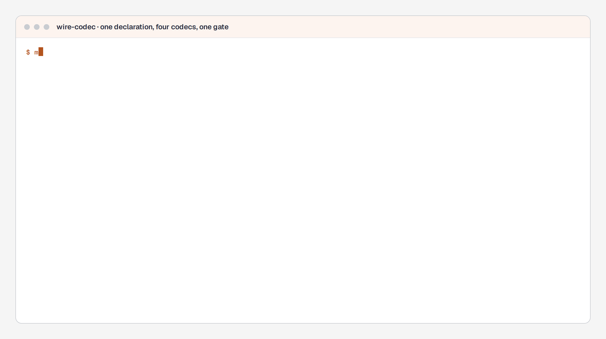

# wire-codec

One declaration, three wire formats, and the tests that make them interchangeable.

A game server's wire format is usually a decision you cannot revisit: the client shipped, the
protocol is in the field, and changing it means a coordinated release. This is the smaller
version of that problem, solved the way I would want it at work: **declare the messages once**,
generate the formats from that declaration, and check that they agree.

```
schema/ops.yaml          the only thing you write by hand
        │
        ├── codec/bytecodec    big-endian layout, no tags, cost known before it is sent
        ├── codec/protocodec   protobuf, compiled from generated .proto at runtime
        └── codec/fbufcodec    FlatBuffers, read without generated code
                    │
        codec.Canonical     the resolution all three share (1 cm, 1/65535 of a turn)
                    │
        JSON in, wire out, wire in, JSON out
```

## Status

| part | state |
|---|---|
| the declaration (`schema/`, YAML, validated) | **done** |
| `byte` codec, from the declaration | **done** |
| `json` codec (the reference) | **done** |
| the gates: cross-format equivalence, faults, sizes, golden bytes | **done, and mutation-checked** |
| `proto` codec, from generated .proto, no protoc | **done** |
| `flatbuf` codec, read without generated code | **done** |
| generating `.proto` and `.fbs` for other languages (`make contract`) | **done** |
| the client-side TypeScript mirror of the contract | **done, and checked for drift** |
| the figure (`docs/figures/wire-codec-flow.html`, generated) | **done, and checked against its sources** |

This table is deliberately not a roadmap: the parts that say "done" are the parts whose tests I
have seen fail for the right reason (`make mutate`).

## What this demonstrates

- Declaring a wire protocol once and generating three formats from it, behind an interface
  (`Codec`) that keeps game logic away from bytes.
- A cross-format gate that is measured rather than asserted: 21 checks over 5 cases, the faults each
  format has to refuse, and golden bytes produced by a second, independent implementation.
- Emitting the client-side artefacts (`wire.proto`, `wire.fbs`, canonical fixtures) from the same
  declaration, so the contract has one author and several readers.
- Keeping a hand-written client mirror honest with a test instead of a review.
- Choosing a format by measurement: the same `Move` is 8 bytes on the declared layout, 29 as
  protobuf, 64 as FlatBuffers and 56 as JSON.

## Repository standard

```bash
make test       # vet, unit tests, and the golden bytes from the second implementation
make mutate     # break the codec on purpose; every mutation has to make the suite red
make contract   # regenerate examples/contract (drift fails the test suite in CI)
make gate       # the interchange gate, in the container
make chart      # lint, render every codec branch, validate with kubeconform
make diagram    # regenerate the figure and check it against its declared sources
```

## The client side of the contract

`make contract` writes the files a client team compiles with its own toolchain:

```
examples/contract/proto/Move.proto     protoc / protobuf-ts / any protobuf runtime
examples/contract/fbs/Move.fbs         flatc, any language
examples/contract/documents.json       the canonical JSON for every declared message
examples/ts-client/contract.ts         the mirror a client engineer reads and edits
```

The `.proto` and `.fbs` are generated; editing them is editing the wrong file. The TypeScript is
hand-written, because it is the file a client team reads and argues with, and it is checked by
`TestTypescriptMirrorsTheDeclaration`: a declared message or field it does not mention fails the
suite. `TestDocumentsSurviveEveryCodec` then puts each fixture through all four codecs, so a
fixture only the JSON codec could read fails here rather than at the client.

I do not write the client. I write the contract, and the tests that say it is still the contract.

## Why three, and why one interface

The requirement was not "support protobuf"; it was **"let a project pick one of three, and
inherit the choice"**. So the unit of work is an interface:

```go
type Codec interface {
    Name() string
    Encode(m *schema.Message, v map[string]any) ([]byte, error)
    Decode(m *schema.Message, b []byte) (map[string]any, error)
}
```

Game logic holds a `Codec` and never a `[]byte`. Swapping formats is a configuration change and
`Name()` is what goes in the configuration (`"byte"`, `"proto"`, `"flatbuf"`).

The three formats are not interchangeable in cost, and this repository does not pretend they
are: the byte format is the cheapest and the least flexible (no field ids means no schema
evolution), protobuf pays tags for evolution, FlatBuffers pays a vtable for zero-copy reads. The
point of one declaration is that you can *measure* that trade instead of arguing about it.

The picture, with the sizes and the gate as they are measured in this repository:


**Figure 1.** One declaration, four wire formats, and the gate that makes them interchangeable. The byte counts are the same `Move` value in each codec, printed by `make gate`; the figure is generated by [`docs/figures/wire-codec-flow.generator.py`](docs/figures/wire-codec-flow.generator.py), and the sources it documents are declared inside the HTML, so `make diagram` fails once the code moves ahead of the picture.

## The gate, running



*`go run ./cmd/wirecodec gate`. The output is the command's; the pauses between lines are the recording's, because the real run takes a tenth of a second.*

## The gates

1. **Every codec agrees on the value.** JSON in, wire out, wire back in, JSON out - and the value
   must survive. This is what lets a project change format without changing its game.
2. **Broken frames are refused.** A truncated frame, an empty frame, bytes the declaration does not
   explain, a string shorter than its own length prefix. A decoder that returns a plausible zero
   for any of these is the failure this repository exists to prevent.
3. **Values that do not fit are refused, not clamped.** 400 metres is not 327.67 metres.
4. **Golden bytes from a second implementation.** The bytes in `codec/golden_test.go` were produced
   by the short Python in `docs/golden-bytes.md`, not by this code. A round trip through one
   implementation proves only that implementation agrees with itself - which is precisely what a
   byte-order bug does. This test is the one that disagrees. It has already caught a real bug:
   `a_raw` arriving as base64 and being encoded as the eight characters of its own spelling.
5. **Every declared message has a case.** Adding a message and forgetting to test it fails a test
   instead of leaving a wire type nobody has ever encoded.

```bash
make test          # all of the above
make mutate        # break the codec on purpose, and require the gate to notice
```

## Layout

```bash
go run ./cmd/layout > docs/byte-layout.md   # the document is generated, not maintained
```
